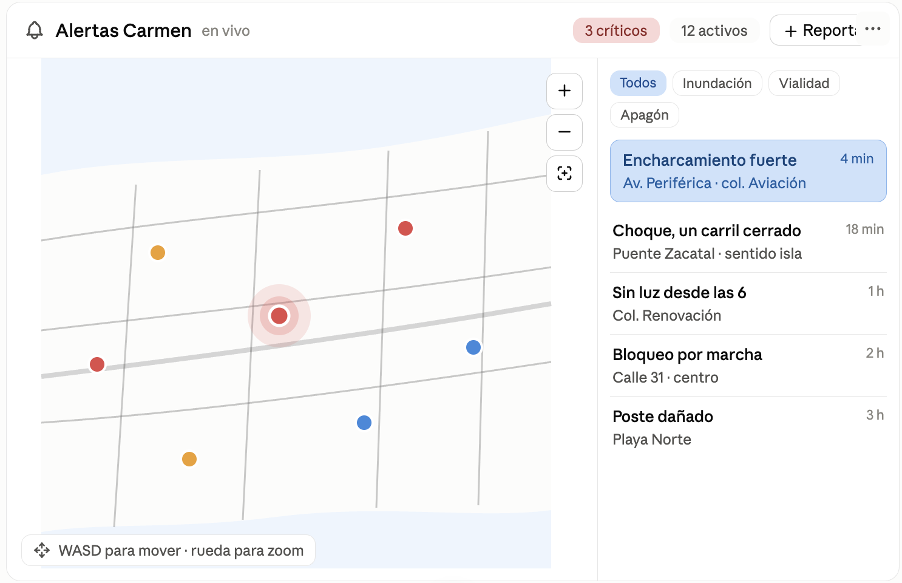

# Carmen Alerta

Frontend de Carmen Alerta creado con React, TypeScript y Vite.

## Desarrollo local

Necesitas Node.js 20.19 o superior. Después ejecuta:

```bash
npm install
npm run dev
```

Vite mostrará en la terminal la URL local de desarrollo (normalmente
`http://localhost:5173`).

## Comandos

- `npm run dev`: inicia el servidor de desarrollo con recarga rápida.
- `npm run build`: valida TypeScript y genera la versión de producción en `dist/`.
- `npm run preview`: sirve localmente la compilación de producción.
- `npm test`: ejecuta las pruebas de regresión de identificadores y cobertura
  (requiere Node.js 22.18 o superior por la ejecución directa de TypeScript).

## Estructura principal

- `src/main.tsx`: punto de entrada de React.
- `src/App.tsx`: arma el layout (barra superior, mapa y panel de incidentes).
- `src/components/`: `TopBar`, `MapView` (mapa Leaflet) e `IncidentPanel`.
- `src/components/Reporte.tsx`: botón animado y apertura del formulario `ReportForm`.
- `src/components/ReportForm.tsx`: formulario accesible con validación, ubicación por GPS o mapa y diseño móvil.
- `src/types.ts`: modelo compartido de categorías y reportes.
- `src/data/`: categorías, reportes de ejemplo y mapeo de filtros.
- `src/utils/formatReportAge.ts`: antigüedad calculada desde `createdAt`.
- `src/styles.css`: estilos globales y del layout.
- `vite.config.ts`: configuración de Vite y el plugin de React.
- `tsconfig*.json`: configuración de TypeScript para navegador y herramientas.

## Imagen de referencia



## Datos de ejemplo

Los incidentes de `src/data/reports.ts` son **ficticios** y sirven solo para
probar la interfaz. Las coordenadas corresponden a lugares reales de Ciudad
del Carmen consultados en OpenStreetMap (o en páginas de Mapcarta basadas en
OpenStreetMap): [Plaza Real](https://www.openstreetmap.org/way/224513587),
[Puente Zacatal](https://www.openstreetmap.org/#map=17/18.630331/-91.825908),
[terminal Playa Norte](https://www.openstreetmap.org/node/3221190021),
[Mercado Alonso Felipe de Andrade](https://www.openstreetmap.org/node/2332266585),
[colonia Playa Norte](https://www.openstreetmap.org/node/2332380663),
[Estadio Resurgimiento](https://www.openstreetmap.org/way/114002721),
[CETis 20](https://www.openstreetmap.org/way/1370895651),
[mercado](https://www.openstreetmap.org/node/14144914637),
[Hospital General](https://www.openstreetmap.org/way/1474191511) y
[Pemex Playa Norte](https://www.openstreetmap.org/way/524527997).

Al cambiar los reportes de ejemplo, el panel y los contadores se actualizan
desde el mismo estado de `App.tsx`. Los chips existentes muestran solo reportes
activos; la categoría «Otro» aparece únicamente al elegir «Todos».

## Crear un reporte

El botón «Reportar» abre un formulario con categoría, descripción de hasta 140
caracteres, severidad cuando la categoría la requiere y ubicación por GPS o mapa.
El GPS requiere HTTPS o localhost y permiso del navegador. También se puede
elegir un punto del mapa con clic o usar el centro después de moverlo con teclado.
El reporte creado aparece seleccionado como «Sin verificar» y actualiza los
contadores. Se guarda solamente en memoria y se pierde al recargar la página.

La zona de cobertura del MVP es un rectángulo aproximado, configurable en
`src/utils/reportLocation.ts`: latitud 18.60–18.72 y longitud −91.88–−91.70.
No representa un límite administrativo oficial. El mismo validador rechaza
puntos fuera de esta zona al elegirlos por GPS, al tocar el mapa y al enviar.
Las coordenadas se conservan en `latitude` y `longitude`; el panel muestra
«Ubicación obtenida por GPS» o «Ubicación seleccionada en el mapa».

La creación funciona por HTTP en la red local aunque el navegador no ofrezca
`crypto.randomUUID()`, gracias a un identificador alternativo. El GPS sigue
requiriendo HTTPS o localhost; en HTTP se puede usar el mapa. La creación se
anuncia en una región de estado para lectores de pantalla.
